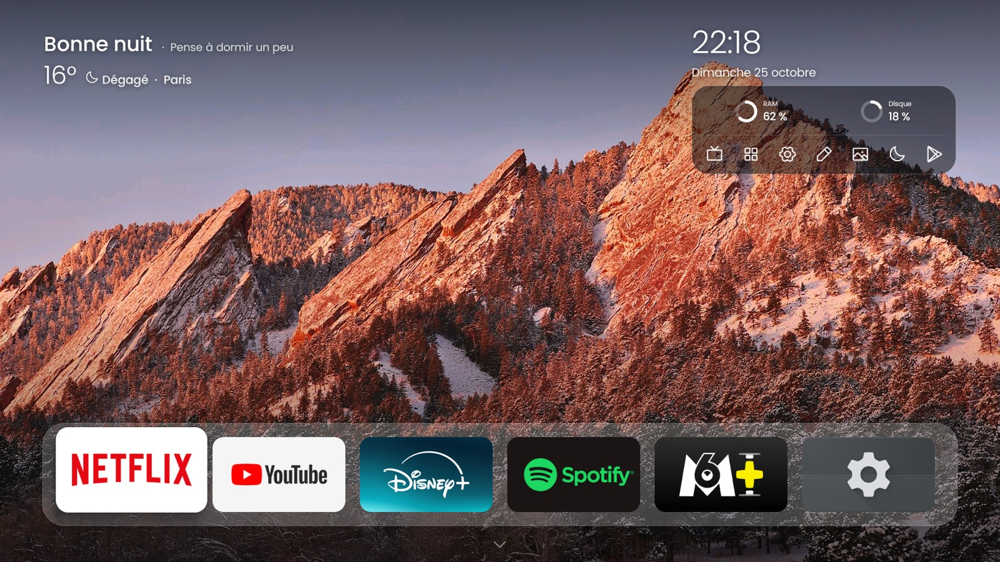
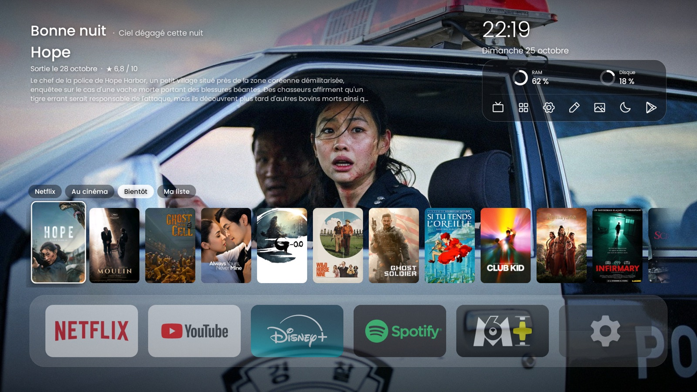
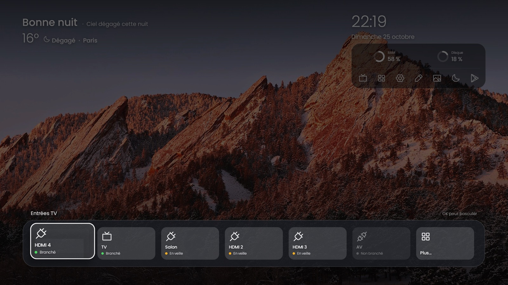
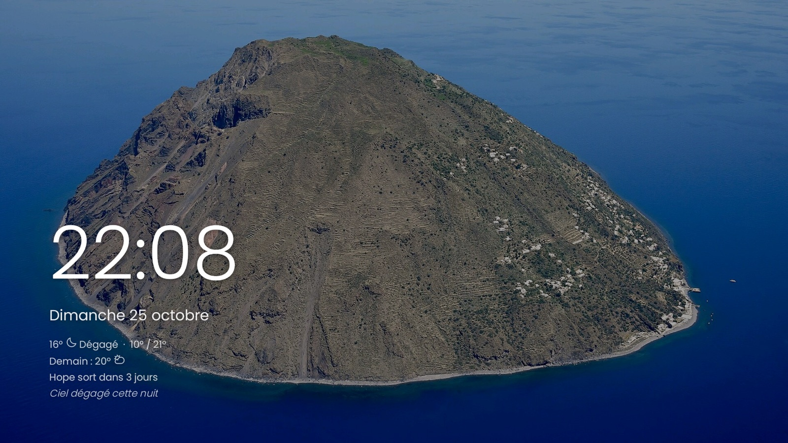
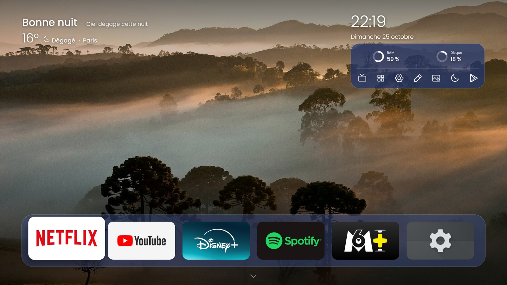

# tcl-zenhome

**Une TV TCL Google TV plus légère, plus calme et sans pub, pilotée depuis votre Mac, sans root.**

Ce projet fait deux choses :

1. **Il allège la TV** : il désactive les applis TCL/Google inutiles (pub, promos, télémétrie, services qui tournent en fond).
2. **Il remplace l'écran d'accueil** par **Zen Home**, un accueil minimaliste : grande photo, heure, météo, films du moment et vos applis.



## Ce que ça fait

**Debloat sans root.** Les paquets listés dans la liste de l'appareil (`tv/debloat-tcl-g08.txt` ou `tv/debloat-mibox4.txt`) sont *désactivés* (`pm disable-user`), jamais désinstallés. Tout est réversible avec `tv/restaurer-tv.sh`.

**Accueil Zen Home**
- **Niveaux** : au repos, photo dégagée avec salutation, heure et dock d'applis. Haut = films et raccourcis, Bas = toutes vos applis.
- **Films via TMDB** : onglets *Netflix*, *Au cinéma*, *Bientôt* et *Ma liste*, avec fiche, fond du film et **bande-annonce** (ouverte dans YouTube).
- **Météo Open-Meteo** : aujourd'hui, heure par heure, semaine ; alerte de pluie imminente.
- **Salutation** selon l'heure, panneau **RAM / disque** et raccourcis (réglages, minuteur, etc.).
- **Entrées en cartes** (HDMI, AV, tuner) avec leur état, ouvertes par la touche Source de la télécommande.
- **Minuteur de veille** avec badge et avertissement une minute avant.
- **Mode ambiance** après 3 minutes sans touche (photo, heure, date) et **économiseur d'écran ZenDream**.
- **Thèmes** : Verre, Nuit, Sable, Forêt, Auto (teinte de la photo).
- **Photos perso** : vos images à la place de celles fournies.
- **Léger** : environ 35 à 40 Mo de mémoire, contre environ 340 Mo pour l'accueil Google TV.

| Films | Entrées | Veille | Thème Nuit |
|---|---|---|---|
|  |  |  |  |

*Photos de fond : Wikimedia Commons, voir [launcher/CREDITS.md](launcher/CREDITS.md). Affiches et images de films : TMDB.*

## Appareils testés

L'appareil visé est choisi par la clé `PROFIL` de `tv/tv.conf` (ou la variable d'environnement), `tcl-g08` par défaut. Les scripts vérifient le modèle à la connexion et demandent confirmation s'il ne correspond pas.

- **TCL G08** (QM6K, « Smart TV Pro »), Google TV, Android 14 : `PROFIL="tcl-g08"`. Ça devrait fonctionner sur d'autres TCL Google TV, **à vos risques** : la liste de debloat (`tv/debloat-tcl-g08.txt`) est propre à ce modèle, relisez-la avant de l'appliquer.
- **Xiaomi Mi Box 4** (MIBOX4), Android TV 9 : `PROFIL="mibox4"`, liste `tv/debloat-mibox4.txt`. Différences avec la TCL :
  - Android 9 n'a pas de rôle HOME : l'accueil Google (`tvlauncher`) passe devant Zen Home tant qu'il est actif, c'est donc `tv/verifier-tv.sh --fix` qui fait de Zen Home l'accueil en le désactivant (avec retour arrière si Zen Home n'apparaît pas).
  - Pas d'entrée HDMI ni de tuner : la carte « Entrées » est masquée et la touche Source n'est pas interceptée.
  - Les boutons Netflix et Prime Video de la télécommande sont gérés par le système et marchent sans l'accueil Google.

Les films sont réglés pour la France (région `FR`, textes en français) ; l'interface existe en français et en anglais selon la langue de l'appareil.

## Prérequis

Un Mac avec [Homebrew](https://brew.sh), et la TV sur le même réseau.

```sh
brew install android-platform-tools openjdk@17
brew install --cask android-commandlinetools
sdkmanager "platforms;android-34" "build-tools;34.0.0"
```

Sur la TV : *Paramètres > Système > À propos*, appuyer 7 fois sur « Build » pour activer le mode développeur, puis *Options pour les développeurs* et activer le **débogage USB / réseau (ADB)**. Notez l'adresse IP de la TV (*Paramètres > Réseau*) et réservez-lui une IP fixe dans votre box ou routeur.

## Première installation, pas à pas

```sh
git clone https://github.com/Tetrax/tcl-zenhome.git
cd tcl-zenhome
```

1. **Configuration** : `cp tv/tv.conf.example tv/tv.conf`, puis éditez `TV_HOST` (IP de la TV), `LAT`, `LON` (météo), `CITY` (nom affiché) et `PROFIL` (appareil, voir plus haut). Ce fichier n'est pas versionné. Pour viser ponctuellement un autre appareil : `PROFIL=mibox4 TV_HOST=192.168.1.60 tv/deployer.sh`.
2. **Jeton TMDB (facultatif, pour les films)** : créez un compte gratuit sur [themoviedb.org](https://www.themoviedb.org), puis *Paramètres > API* et copiez le « API Read Access Token ». Enregistrez-le dans un fichier `tmdb.token` à la racine, **sans le coller dans un chat, un ticket ou une commande**. Depuis le terminal, sans afficher la valeur :
   ```sh
   (umask 077; pbpaste > tmdb.token); pbcopy </dev/null   # après avoir copié le jeton ; vide ensuite le presse-papiers
   ```
   Sans jeton, tout fonctionne sauf les films.
3. **Relire les commandes** : `tv/deployer.sh --dry-run` affiche ce qui sera fait sans rien exécuter.
4. **Installer** : `tv/deployer.sh`. Au premier contact, acceptez l'autorisation ADB sur l'écran de la TV. Le script lance les tests, compile l'appli, l'installe, la configure, active l'écran de veille et ouvre l'accueil.
5. **Appliquer le debloat** : `tv/verifier-tv.sh --fix`.

## Partager avec des amis (kit Mac)

Le dossier `kit/` contient un kit « double-clic » pour la Xiaomi Mi Box 4 : `Zen Home.command` guide un non-technicien par des fenêtres macOS (adb téléchargé et vérifié, choix du debloat, sauvegarde, retour arrière), avec le mode d'emploi `kit/LISEZMOI.html`.

- **Produire l'archive** : `kit/empaqueter.sh <version>` (la version doit égaler `KIT_VERSION` de `Zen Home.command`, l'arbre git doit être propre). Il lance tests et build, vérifie l'empreinte du certificat de signature (`kit/certificat-attendu.txt`), assemble une liste blanche de fichiers et crée `kit/dist/ZenHome-MiBox4-<version>.zip`. La publication reste manuelle : la commande `gh release create` est affichée à la fin.
- **Sauvegardez impérativement `launcher/key.jks` et `launcher/keystore.pass`** (jamais publiés). Avec une autre clé, les mises à jour de vos amis échoueraient ; `empaqueter.sh` refuse alors d'empaqueter.
- **Options de `tv/deployer.sh` utilisées par le kit** : `--sans-build` (utilise l'APK déjà compilé du kit) et `TMDB_TOKEN_FILE=<fichier>` (jeton TMDB ailleurs que dans `./tmdb.token` ; vide = pas de jeton).

## Les scripts

| Script | Rôle |
|---|---|
| `tv/deployer.sh [--capture] [--reset-dock]` | Tests, build, installation et configuration (ville, jeton, permissions, accessibilité, écran de veille, accueil). Idempotent. `--reset-dock` remet dock et disposition à zéro ; sans lui, vos réglages faits sur la TV sont conservés. |
| `tv/verifier-tv.sh [--fix]` | Tableau OK / KO / AVERT, à lancer **après une mise à jour TCL ou Google** (elles réactivent parfois des paquets). `--fix` réapplique ce qui manque et revient en arrière si Zen Home n'apparaît pas. |
| `tv/photos.sh [--replace] <dossier>` | Convertit vos photos (JPEG, 1920 px max) et les envoie dans `/sdcard/ZenHome/`. `--reset` revient aux photos fournies. |
| `tv/restaurer-tv.sh` | Annule tout : réactive **tous** les paquets désactivés (y compris ceux désactivés à la main), remet l'accueil et l'écran de veille d'origine de l'appareil, retire Zen Home. |

Tous acceptent `--help` et `--dry-run`.

## Utilisation à la télécommande

| Geste | Effet |
|---|---|
| **Haut** (depuis le repos) | Films (si jeton TMDB), puis onglets, puis raccourcis |
| **Bas** (depuis le repos) | Carrousel de toutes vos applis |
| **Gauche** (sur le premier raccourci) | Météo de la semaine |
| **Gauche / Droite** sur les onglets | Netflix, Au cinéma, Bientôt, Ma liste |
| **OK** sur une affiche | Fiche du film, bande-annonce |
| **Retour** | Redescend d'un niveau vers le repos (l'accueil ne se ferme jamais) |
| **Menu** (ou OK long) sur une appli | Menu : déplacer, remplacer, retirer, ajouter |
| **Menu** sur une affiche | Ajouter à / retirer de *Ma liste* |
| **Menu** ailleurs | Mode édition de l'accueil |
| **Touche Source / TV** | Panneau des entrées en cartes |
| **Touche Réglages** | Depuis l'accueil : menu Réglages (Image, Son, tous les paramètres). Dans les autres applis : panneau rapide Image de TCL (service d'accessibilité) |
| Raccourci **Applis ouvertes** | Liste des applis récentes (encore en mémoire) : OK ferme une appli, « Tout libérer » les ferme toutes et affiche la mémoire gagnée |
| **Menu** d'une tuile, « Fermer l'appli » | Ferme l'appli d'arrière-plan (jamais Zen Home ni les paquets système critiques) |
| Raccourci **minuteur** | Programmer la veille (badge du temps restant) |
| Mode édition (Menu), entrée « Thème » | Changer la couleur du verre |
| Aucune touche pendant 3 min | Mode ambiance ; la première touche réveille l'écran |
| Boutons Netflix / YouTube / Prime de la télécommande TCL | Ouvrent l'appli (service d'accessibilité installé par `deployer.sh`) |

**Permission des « Applis ouvertes »** : la liste des applis récentes demande l'accès aux statistiques d'usage, accordé par `tv/deployer.sh` et `tv/photos.sh` (qui accordent les permissions), et réappliqué par `tv/verifier-tv.sh --fix` : `adb shell appops set tv.zenhome GET_USAGE_STATS allow`. Sans elle, l'écran affiche « Autorisation requise : voir README » et « Tout libérer » n'agit que sur le dock et le carrousel. « Fermer l'appli » n'a pas besoin de cette autorisation.

## Configuration avancée par adb

Réglages lus quand `zenhome_rev` change (le `deployer.sh` ne les touche pas, sauf `--reset-dock`) :

```sh
adb shell settings put global zenhome_dock     com.netflix.ninja,com.google.android.youtube.tv   # applis du dock (ou « auto »)
adb shell settings put global zenhome_layout   6          # nombre d'applis du dock, 2 à 10
adb shell settings put global zenhome_title_mode custom   # device | none | custom
adb shell settings put global zenhome_title_b64  "$(printf 'Salon' | base64)"   # titre si custom
adb shell settings put global zenhome_theme    night      # glass | night | sand | forest | auto
adb shell settings put global zenhome_interval 60         # secondes entre deux photos
adb shell settings put global zenhome_rev      "$(date +%s)"   # à faire en dernier : applique les clés présentes
```

Ville et météo, ou retrait du jeton TMDB (broadcast protégé par la permission `DUMP` : seul `adb` peut l'appeler) :

```sh
adb shell am broadcast -a tv.zenhome.CONFIG -n tv.zenhome/.ConfigReceiver --es lat 48.86 --es lon 2.35 --es city Paris
adb shell am broadcast -a tv.zenhome.CONFIG -n tv.zenhome/.ConfigReceiver --ez clear_tmdb true
```

Pour le jeton TMDB, passez par `tv/deployer.sh` : il l'envoie sans l'afficher.

## Sécurité et vie privée

- **Aucun envoi hors de 3 hôtes** : `api.open-meteo.com` (météo), `api.themoviedb.org` (films) et `image.tmdb.org` (affiches). Liste blanche dans le code (`Net.java`). Pas de pisteur, pas d'analytique, pas de compte. L'appli ne journalise ni URL ni jeton.
- **Open-Meteo reçoit les coordonnées** que vous configurez ; **TMDB reçoit votre jeton** (pas votre identité).
- Le jeton TMDB est stocké dans les préférences **privées** de l'appli sur la TV, jamais dans les réglages système.
- **Coupez le débogage ADB réseau quand vous ne vous en servez pas** : il donne le contrôle total de la TV à tout appareil autorisé du réseau local. *Options pour les développeurs > Débogage USB / réseau*, et « Révoquer les autorisations de débogage USB » pour oublier les Mac autorisés. Réactivez-le avant d'utiliser les scripts.
- **Play Protect** peut signaler l'installation : choisissez « Installer quand même » (l'appli est signée par votre propre clé, compilée chez vous).
- Ne publiez jamais `tmdb.token`, `tv/tv.conf`, `launcher/key.jks` ni `launcher/keystore.pass` (ils sont dans `.gitignore`).

## Avertissements honnêtes

- **Désactiver des applis système peut casser des fonctions** (réglages TCL, recherche vocale, mises à jour, etc.). Chaque paquet est commenté dans la liste de l'appareil (`tv/debloat-*.txt`) : relisez, retirez une ligne si besoin. Aucun script ne désinstalle quoi que ce soit.
- **Une mise à jour système peut réactiver** des paquets ou changer l'accueil : relancez `tv/verifier-tv.sh --fix`.
- **Sauvegarde / restauration** : `tv/restaurer-tv.sh` réactive les paquets et remet l'accueil Google. En cas d'écran noir au retour à l'accueil : `adb shell pm enable com.google.android.apps.tv.launcherx` (TCL) ou `adb shell pm enable com.google.android.tvlauncher` (Mi Box 4).
- **Wi-Fi et `setupwraith`** : sur certaines TV, le Wi-Fi est lié à `com.google.android.tungsten.setupwraith`. Le script affiche AVERT et ne le désactive pas dans ce cas, pour ne pas vous faire perdre le réseau.
- **Sauvegardez votre clé de signature** : `launcher/key.jks` et `launcher/keystore.pass` sont créés au premier build et ne sont pas versionnés. Sans eux, une nouvelle clé sera générée et Android refusera la mise à jour (`INSTALL_FAILED_UPDATE_INCOMPATIBLE`) : il faudra désinstaller Zen Home à la main (`adb uninstall tv.zenhome`) et perdre ses réglages.
- **Dépannage rapide** : TV injoignable ? Vérifiez `TV_HOST`, l'IP fixe, que le débogage ADB est actif, et ré-acceptez l'autorisation sur la TV.
- Projet communautaire, **non affilié à TCL, Google, Netflix ni TMDB**. Fourni tel quel, sans garantie (voir `LICENSE`).

## Développement

```
launcher/   code de Zen Home (Java, sans Gradle), build-mac.sh, test-mac.sh, CREDITS.md
tv/         deployer.sh, verifier-tv.sh, photos.sh, restaurer-tv.sh, lib.sh,
            debloat-tcl-g08.txt, debloat-mibox4.txt, tv.conf.example
docs/       architecture.md, captures/
```

```sh
launcher/test-mac.sh    # compile les classes pures sans android.jar et lance les tests JVM
launcher/build-mac.sh   # produit launcher/out/ZenHome.apk (signé)
```

L'architecture (classes pures testées sur le JVM, classes Android, navigation par niveaux) est décrite dans [`docs/architecture.md`](docs/architecture.md).

**Contribuer** : les issues et pull requests sont bienvenues, en particulier des listes de debloat pour d'autres modèles TCL (un fichier `tv/debloat-<modèle>.txt` par modèle, avec le résultat de `verifier-tv.sh`). Gardez les diffs petits, lancez `launcher/test-mac.sh` avant d'envoyer, et ne mettez ni IP, ni coordonnées, ni jeton dans les exemples.

## Crédits et licences

- Code du dépôt : [MIT](LICENSE), © 2026 Tetrax.
- **Zen Home d'origine** : [xMazaki/unbloat-android-tv](https://github.com/xMazaki/unbloat-android-tv) (MIT, version 2.6, voir `launcher/UPSTREAM.txt` et `launcher/LICENSE`).
- **Inspiration du debloat** : [Gathin23/cleanyourtv](https://github.com/Gathin23/cleanyourtv), dont les listes TCL ont servi de base à `tv/debloat-tcl-g08.txt`.
- **Police** : Poppins (Indian Type Foundry), [SIL OFL 1.1](https://openfontlicense.org).
- **Icônes** : [Phosphor Icons](https://phosphoricons.com) (MIT).
- **Photos** : Wikimedia Commons, chacune sous sa licence (CC BY-SA), détail dans [`launcher/CREDITS.md`](launcher/CREDITS.md).
- **Météo** : données [Open-Meteo.com](https://open-meteo.com), licence [CC BY 4.0](https://creativecommons.org/licenses/by/4.0/) (usage non commercial de l'API gratuite).
- **Films** : *This product uses the TMDB API but is not endorsed or certified by [TMDB](https://www.themoviedb.org).*

## English

**tcl-zenhome** debloats a TCL Google TV (tested on the TCL G08 / QM6K, Android 14) or a Xiaomi Mi Box 4 (Android TV 9, set `PROFIL="mibox4"` in `tv/tv.conf`) and replaces its home screen with **Zen Home**, a lightweight launcher (about 35 to 40 MB of RAM versus about 340 MB for the stock Google TV home). Everything is driven from a Mac over `adb`, with no root.

- Debloat: unwanted TCL/Google packages are **disabled, not uninstalled** (`pm disable-user`), and `tv/restaurer-tv.sh` undoes it all.
- Launcher: photos, clock, weather (Open-Meteo), movies with trailers (TMDB, free token), TV inputs panel, sleep timer, ambient mode and screensaver, themes, your own photos.
- Quick start: `brew install android-platform-tools openjdk@17`, `brew install --cask android-commandlinetools`, install the SDK platform and build-tools (see above), enable ADB debugging on the TV, copy `tv/tv.conf.example` to `tv/tv.conf`, optionally put your TMDB read token in `tmdb.token`, then run `tv/deployer.sh` and `tv/verifier-tv.sh --fix`.
- Privacy: only three hosts are contacted (`api.open-meteo.com`, `api.themoviedb.org`, `image.tmdb.org`). No tracker. Turn network ADB off when you are done.
- Risks: disabling system apps can break features. It may work on other TCL Google TVs, at your own risk. The movie tabs are configured for France (region `FR`).
- Not affiliated with TCL, Google, Netflix or TMDB. Keep your `launcher/key.jks` and `launcher/keystore.pass` safe. Licensed under MIT.
- This product uses the TMDB API but is not endorsed or certified by [TMDB](https://www.themoviedb.org). Weather data by [Open-Meteo.com](https://open-meteo.com) (CC BY 4.0).
